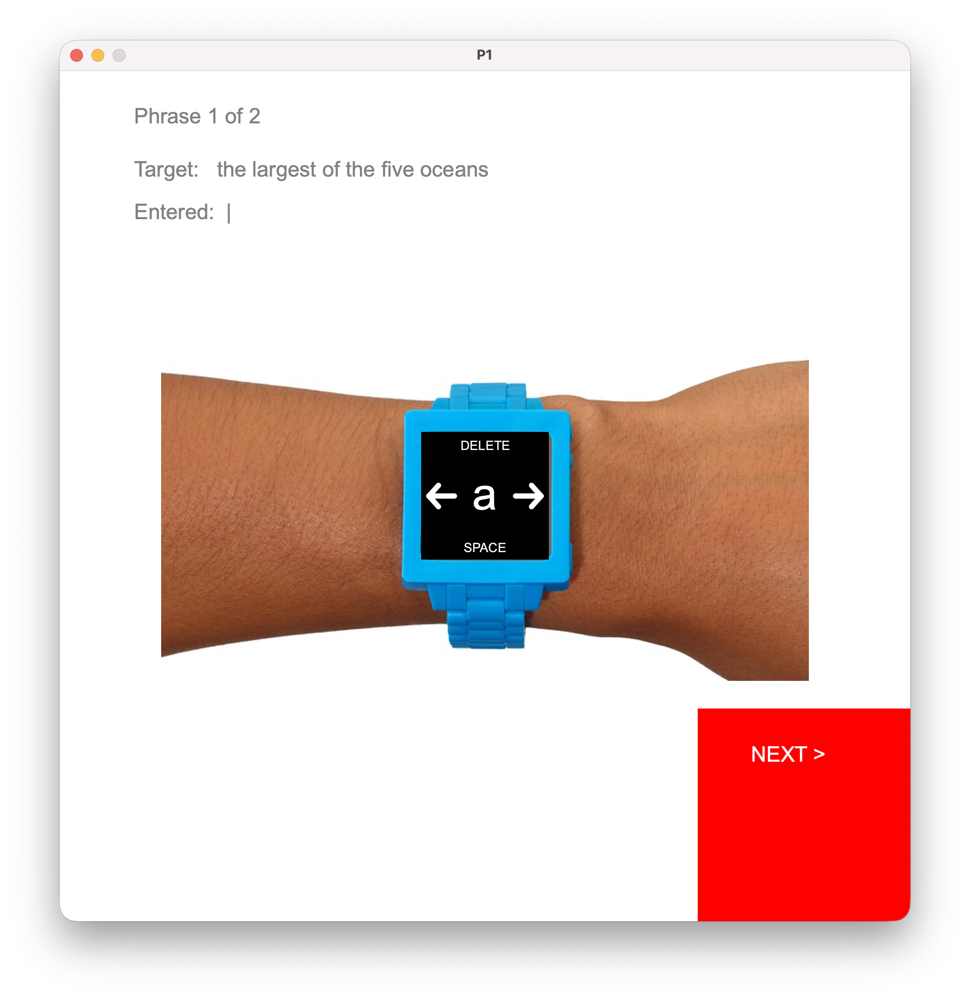
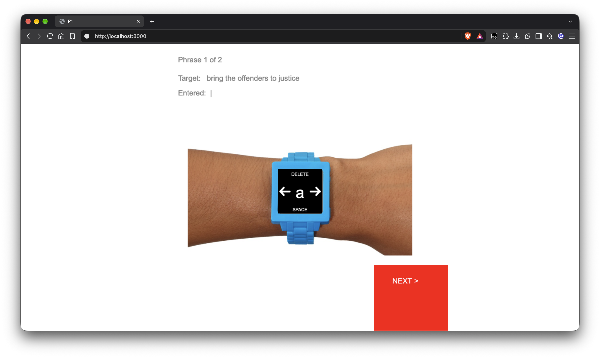

# Bakeoff 3: Prototype 1

The original Processing sketch, `P1.pde`, has been modified for compatibility with both the Processing IDE (Java mode) and Processing.js in a web browser using `index.html`.

## Screenshots

<details markdown="1">

<summary><strong>Processing IDE (Java Mode)</strong></summary>



</details>

<details markdown="1">
<summary><strong>Web Browser (Processing.js)</strong></summary>



</details>

## Processing IDE (Java Mode)

1. Download and install the [Processing IDE](https://processing.org/download).
2. Open `P1.pde` in Processing.
3. Select **Java** mode and click **Run**.

## Web Browser (Processing.js)

Run the following commands from a terminal:

```bash
cd path/to/P1
python3 -m http.server 8000
```

Then open [http://localhost:8000/](http://localhost:8000/) in your browser.

To stop the server, press `Ctrl+C`.

> [!NOTE]
> **Note:** Do not open `index.html` directly using `file://`, as browsers may block local file requests. Use the HTTP server instead.

## Compatibility Notes

The original sketch was adapted to support both Java and JavaScript execution. Changes include replacing Java-specific utilities with Processing-compatible alternatives and adjusting asset loading and font handling.

Both versions use the same `P1.pde` source code and experiment logic.

**Requirements:**

* **Java Mode:** Processing IDE
* **Web Browser:** Python 3, a modern web browser, and Processing.js (included)

## Project Files

```plaintext
├── data
│   ├── phrases2.txt
│   └── watchhand3smaller.png
├── P1.pde
├── processing.min.js
├── README.md
└── index.html
```

* `P1.pde`— Main Processing sketch containing the interface, interaction logic, and experiment calculations. Modified to support both Java mode and Processing.js.
* `index.html`— Webpage that loads and runs the sketch in a browser.
* `processing.min.js` — Processing.js library required to execute the `.pde` file in a browser.
* `data/`— Directory containing the assets used by the sketch.

The `data/` directory must be preserved for the sketch's assets to load correctly. The Processing IDE runs `P1.pde` directly, while the browser requires `index.html` and `processing.min.js`.
